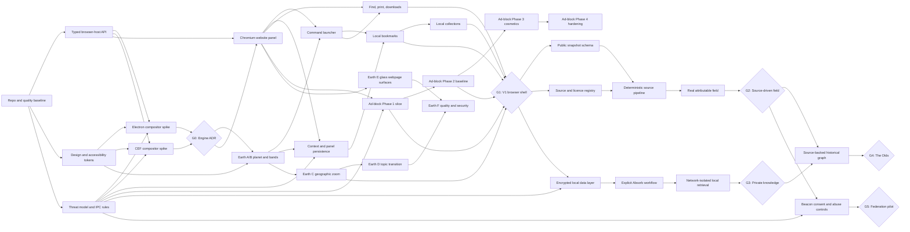

# Intoponet delivery DAG

This plan translates the PRD and the two follow-up specs into dependency-gated
work. A node may start only when every incoming dependency is complete. Gates
are evidence-producing milestones, not calendar dates.

Companion specs:

- `INTOPONET_EARTH_FREQUENCY_SPEC.md` — Earth + frequency membrane, Phases A–F
- `docs/INTOPONET_NATIVE_AD_BLOCKING_SPEC.md` — native request blocking, Phases 0–5

## Active cut: V1 browser shell

| Node | Spec / PRD | Depends on | Exit evidence | State |
|---|---|---|---|---|
| `R` | PRD §7.1, §14, §16 | — | Workspace, scripts, test/build baseline | Complete |
| `API` | P0-03, §6.4 | `R` | Typed, runtime-validated host contract; no generic bridge | Complete |
| `TOK` | P1-02, §5, §12, Earth §9 | `R` | Contrast, focus, reduced-motion/transparency tokens | Provisional |
| `SEC` | P0-04, §6.3–6.4, §11 | `R` | Sandboxed renderer and documented trust boundaries | Provisional |
| `EL` | P0-02 | `API`, `TOK`, `SEC` | Real HTTPS page over/within field shell; measurements | Evidence partial |
| `CEF` | P0-01 | `API`, `TOK`, `SEC` | Equivalent native prototype and measurements | Evidence partial |
| `ADR1` | ADR-001/002 | `EL`, `CEF` | Published decision using the same benchmark matrix | Blocked |
| `FIELD` | Earth Phases A–B | `ADR1`, `TOK` | Recognizable Earth + independent displaced membrane | Provisional |
| `PANEL` | P1-04, Earth §7 | `ADR1`, `API` | Navigate, resize, focus, close/restore real page | Provisional |
| `CMD` | P1-03, WEB-002/008 | `FIELD`, `PANEL` | URL, search and topic modes; keyboard-first | Provisional |
| `STATE` | EXP-004, WEB-005 | `FIELD`, `PANEL`, `SEC` | Camera/selection and safe panel metadata restored | Provisional |
| `BOOK` | P1-05, MEM-002/003 | `CMD`, `STATE` | Inspect, reopen and delete URL plus field anchor locally | Provisional |
| `COL` | MEM-004/005 | `BOOK` | Named, renameable local collections of saved pages | Provisional |
| `FIND` | WEB-007 | `CMD`, `PANEL` | Find-in-page, print, zoom, stop, downloads, launcher URL detect | Provisional |
| `PROTECT` | Ad-block Phase 1 | `PANEL`, `SEC` | Local engine blocks fixture requests before download; shield via IPC | Provisional |
| `EARTHC` | Earth Phase C | `FIELD` | Earth → region → city LOD; interruptible camera; no hard cuts | Provisional |
| `EARTHD` | Earth Phase D | `EARTHC` | Enter/exit a topic and return to the same viewpoint | Provisional |
| `EARTHE` | Earth Phase E | `PANEL` | Glass-frame open/close synced to native bounds | Provisional |
| `EARTHF` | Earth Phase F | `EARTHD`, `EARTHE` | Reduced motion, isolation, synthetic disclosure, stable frame time | Provisional |
| `PROTECT2` | Ad-block Phase 2 | `PROTECT` | Broader local baseline, category toggles, per-page counters | Provisional |
| `PROTECT3` | Ad-block Phase 3 | `PROTECT2` | Frame-scoped cosmetic selectors; premium shield settings | Provisional |
| `PROTECT4` | Ad-block Phase 4 | `PROTECT3` | Verified list updates, rollback, private-mode and perf evidence | Blocked (licence) |
| `G1` | Phase 1 gate | `BOOK`, `COL`, `FIND`, `PROTECT`, `EARTHC`, `PROTECT2` | Arbitrary HTTPS form works and context is restored | Provisional |
| `SCHEMA` | P2-02 public snapshot | `G1` | Versioned field snapshot with bounded intensity | Provisional |
| `REG` | P2-01 source registry | `G1` | Every fixture source has a licence, attribution, and URL | Provisional |
| `INGEST` | Deterministic pipeline | `SCHEMA`, `REG` | Dedupe, recency, and aggregate without a network fetch | Provisional |
| `REAL` | Real attributable field | `INGEST` | Live licensed sources drive the field | Provisional |
| `DB` | Encrypted local store | `G1`, `SEC` | Private library sealed with the OS keychain | Provisional |
| `ABS` | Explicit absorb | `DB` | User-written excerpt, citation, sensitive sites refused | Provisional |
| `LAYA` | Local retrieval | `ABS` | Keyword retrieval on device; no model and no egress | Provisional |
| `G3` | Private knowledge gate | `LAYA` | Absorb and retrieve while Laya has no network | Provisional |
| `OLDS` | Historical graph | `G2`, `G3` | Analogy and sequence are not shown as causes | Blocked (`G2`) |
| `G2` | Source-driven field | `REAL` | Real attributable updates | In progress |
| `BEACON` | Beacon consent | `G2`, `SEC` | No private graph leaves the device | Blocked (`G2`, ADR-006) |

“Provisional” means implemented behind the engine abstraction before ADR-001;
it must be revalidated against the selected host.

`PROTECT4` stays blocked until EasyList / EasyPrivacy / adblock-rust licence and
attribution review. Do not fetch or bundle those lists before that review.

### Current implementation evidence

- The host accepts only copied, runtime-validated commands with bounded strings,
  finite panel geometry and explicit discriminants.
- Website renderers have no preload or Node integration; the shell preload
  exposes only the typed browser-host contract.
- URL, panel geometry and visibility restore from a local mode-`0600` metadata
  file. Website cookies and storage remain in a dedicated Chromium partition.
- Bookmarks preserve URL, title, field topic and timestamp in local storage and
  support inspect, reopen and delete actions.
- Collections group those pages locally and can be renamed. Bookmarks accept a
  private note. Find-in-page, print, zoom, stop-loading, copy-address and
  Downloads-folder saves are exposed through the typed host API. The launcher
  promotes a typed host to a URL from any mode and keeps the current address
  visible. A crashed page renderer is recreated and reloads the last trusted
  HTTP(S) URL. Recent pages stay in local storage. The website panel opens with
  a short motion that respects reduced-motion.
- `npm start` / `npm run dev` unset `ELECTRON_RUN_AS_NODE` so the desktop app
  launches even when that variable is inherited from the shell.
- Contract tests, TypeScript validation and the production build remain the
  current verification bar. Native interaction and accessibility evidence remain
  required before `G1`.
- Earth follows `INTOPONET_EARTH_FREQUENCY_SPEC.md` Phases A–B: a recognizable
  sphere with an independent, translucent frequency membrane displaced by
  synthetic geodesic bands. The membrane is labeled synthetic. ADR-003 remains
  open for later globe/field transitions. Guest pages prefer a light color
  scheme.
- Native request blocking is a host `ProtectionAdapter` with local fixture
  hosts, Electron `webRequest` cancellation, validated `get-protection` /
  `set-site-protection` / `set-protection-categories` IPC, fixture cosmetic
  CSS on guest frames, including subframes, and a restrained shield in website chrome. EasyList
  is not bundled. Per-site pauses and category toggles persist locally with
  mode `0600`.
- Earth Phase C is in the shell: Earth → region → city → topic, geographic
  topic anchors, interruptible eased orbit, wheel-mapped scale, and a
  persisted viewpoint. Fine city-scale ripples are synthetic and labelled.
- Earth Phase D stores the orbit before entering a topic and restores that
  exact heading and distance on the way back. Related topics are a synthetic
  graph.
- Closing the page returns keyboard focus to the launcher and leaves the field
  viewpoint where it was. Arrow keys orbit that viewpoint when the page and
  the library are closed. The scale path and topic list stay available to
  keyboard and screen-reader users, including on a narrow window. The field
  stops redrawing while a page is full width. An untrusted site certificate
  is refused and reported as a failed navigation. Changing advertising or
  tracking protection reloads the open page.
- The field membrane is driven by a versioned `intoponet.field-snapshot.v1`
  document. The rendered topography follows the sources: each place is scored by
  weight, recency, distance from its topic anchor, and a smaller share for a
  repeated publisher. Nearby places of one topic become a wave corridor.
  Planet scale keeps that corridor broad. City and topic scale use a shorter
  wavelength. A related topic can add a low overlap between corridors, and
  the displacement stays saturated so crossings do not become spikes.
  A change of scale or snapshot eases the corridor geometry and colour over
  about two seconds. Reduced motion snaps that change instead of animating it.
  The demo snapshot stays labelled as not public activity. Duplicate URLs collapse. Intensity stays in 0..1.
  A public-record cell is labelled public-aggregate only when every source in
  it is a public record. The live field reads English Wikipedia titles and
  coordinates near four public anchors and weights them by the last week of
  public pageviews. Article text is not stored. The same snapshot can include
  USGS earthquakes of magnitude 4.5 or greater from the last week. Those are
  public-domain event records: place, time, link, and a bounded magnitude
  weight. Magnitude is a physical measurement, not importance. If one source
  fails, the other is kept. The coverage note says this
  is not the whole web. A snapshot older than a day is marked stale. If the
  fetch fails, the synthetic snapshot stays on screen and stays labelled.
- The private library is sealed with the operating-system keychain when that
  encryption is available. Absorb stores only an excerpt the user writes, keeps
  the page URL as the citation, and refuses banking, health, and account hosts.
  Search runs on this device. Export writes a local JSON file. Delete clears
  the library. There is no embedding model and no Laya network request.
- Historical fixture links label analogy and sequence as not causes. A full
  historical graph, licensed filter lists, and the engine choice stay blocked.
- The shared `compositor-v1` workload and Electron runner now emit versioned
  machine-readable evidence. Five corrected M4 runs matched the available 30 Hz
  display with zero frames over 120% of its frame budget; this does not validate
  the 60 fps target. CEF 156.0.8 now has a matching native-child five-run
  baseline from the external build volume: about 30.05 fps, 303 MiB working
  set, steadier Electron transitions. Electron decoded local H.264 and VP8;
  official CEF rejected H.264 and hung on VP8. Higher-refresh, IME, VoiceOver
  and crash-recovery runs remain `G0` blockers.

## Gate evidence

### G0 — engine and compositor

- Run the same HTTPS, long-scroll, input/IME, video, WebGL, permission,
  accessibility, crash-recovery and resize scenarios in Electron and CEF.
- Record frame time, interaction latency, memory, layering limitations,
  sandbox/site-isolation posture, update path and developer effort.
- Do not select an engine from aesthetics alone.

### G1 — V1 browser shell

- Direct URL navigation remains one action away and arbitrary HTTPS forms work.
- Closing and restoring Focus returns to the same field selection and view.
- Origin is continuously visible; privileged Node APIs are absent from pages.
- Keyboard-only and reduced-motion journeys pass.
- Synthetic data is visibly labelled and cannot be confused with public data.
- Earth → region → city zoom is continuous and interruptible.
- A representative ad/tracker request is blocked before download.

## Deferred branches

Real public discovery (`G2`), Laya/private knowledge (`G3`), The Olds (`G4`),
beacons/federation (`G5`) and community connectivity are intentionally outside
the first cut. Community connectivity remains an independent research DAG and
is not a release dependency for the browser. Licensed public filter lists and
adblock-rust stay in `PROTECT4` until review.
